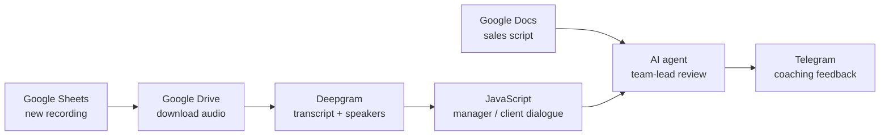

# AI Sales Coach — every sales call reviewed like a team lead would

> n8n + Deepgram + LLM agent that reviews sales calls against your own sales script and sends coaching feedback to Telegram.

 

## Problem

- A team lead can't listen to every call, so managers rarely get feedback on their real conversations.
- Feedback is late and inconsistent; coaching depends on the reviewer's time and mood.

## Solution

Built in **n8n**:

1. Checks Google Sheets every 2 minutes for new call recordings
2. Downloads the recording from Google Drive
3. Transcribes it with Deepgram (nova-3) with speaker diarization
4. Builds a readable manager / client dialogue in JavaScript
5. Loads the company's sales standards and script from Google Docs
6. AI agent reviews the call like an experienced team lead: no scores, a mentor's tone
7. Sends strengths, key mistakes, better phrasing and coaching tips for the team lead to Telegram

## Architecture

## Tech stack

- n8n
- Deepgram (nova-3, diarization)
- OpenRouter (LLM)
- Google Sheets, Drive, Docs
- JavaScript
- Telegram Bot API

## Results

- Every recorded call gets a structured coaching review without the team lead listening to it
- Feedback is based on the company's own script, not generic sales advice
- Low running cost: works on a free OpenRouter model

## Workflow files

Workflow JSON exports are in [`workflows/`](workflows). Credentials, IDs and personal data are removed: import into n8n and connect your own credentials.

## Case study & demo

Full case study with screenshots and a demo video: **[Notion portfolio](https://tree-plantain-8cf.notion.site)**

## Author

**Kyrylo Kirillov** — AI Automation Engineer (n8n, Make, LLM agents)  
[Upwork](https://www.upwork.com/freelancers/~019bcb1ca9cd59b3ad) · [LinkedIn](https://www.linkedin.com/in/kirillov-kirill) · [Portfolio](https://tree-plantain-8cf.notion.site) · Telegram [@Veter218](https://t.me/Veter218)
